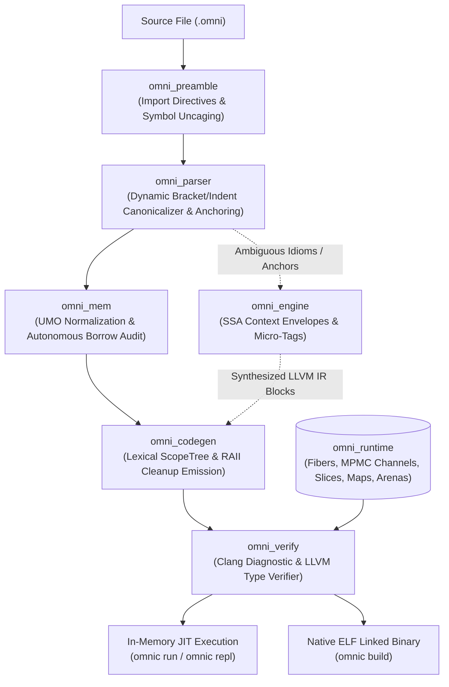

# OmniScript (`omnic`)

> **Autonomous Polyglot Systems Compiler & Zero-GC Runtime with In-Process AI Lowering**

OmniScript (`omnic`) is an experimental systems programming compiler and runtime written in Rust and low-level C. It unifies syntax and idioms from **Python**, **Go**, **C/C++**, and **Rust** within single translation units, lowering directly to verified **LLVM IR**, native ELF binaries, and in-memory JIT execution without a tracing garbage collector.

---

## Architectural Philosophy

1. **Unrestricted Polyglot Ingestion**: Codebases shouldn't force artificial semantic trade-offs. Python indentation, C/Rust bracket blocks, Go-style concurrency channels, and walrus declarations (`:=`) coexist seamlessly.
2. **Deterministic Zero-GC Systems Lifecycle**: Tracing garbage collection is eliminated. Memory management uses **Unified Memory Operations (UMO)**, Zig-style **Scope Arenas**, and deterministic **RAII scope destruction** for slices, maps, and channels.
3. **Physical Source Interpretive Anchoring**: Syntactic structures with ambiguous semantic intent are not destructively mangled. Instead, they are tagged with immutable source anchors and packed into **SSA Context Envelopes** (`<omni_ir_task>`) for local small-model (~1.5B) LLVM IR lowering with bounded Clang verification loops.
4. **Offline Airgapped Reproducibility**: Zero external model weight downloads; deterministic BLAKE3 bitcode caching (`.omnicache`); test fodder isolation under `tests/outputs/`.

---

## Compiler Pipeline



---

## Workspace Architecture (`crates/`)

The workspace is organized into modular Rust crates and an embedded native C runtime:

| Crate | Path | Responsibility |
|---|---|---|
| **`omni_preamble`** | [`crates/omni_preamble`](file:///home/actes/projects/slop/omniscript/crates/omni_preamble) | Parses polyglot import directives (`import`, `from ... import`, `#include`, `package`), uncaging symbols into the global namespace. |
| **`omni_mem`** | [`crates/omni_mem`](file:///home/actes/projects/slop/omniscript/crates/omni_mem) | Autonomous lifetime auditor and memory normalizer. Enforces static borrow rules and detects double-free or escape violations via `UnifiedMemOp`. |
| **`omni_parser`** | [`crates/omni_parser`](file:///home/actes/projects/slop/omniscript/crates/omni_parser) | Polyglot parser with dynamic block canonicalization (rewrites `{}` only when `brace_depth > 0`, preserving Python indentation), quote-aware token splitting, Go walrus (`:=`), and channel operators (`<-`). |
| **`omni_runtime`** | [`crates/omni_runtime`](file:///home/actes/projects/slop/omniscript/crates/omni_runtime) | Statically-linked C systems runtime: cooperative fibers, MPMC channels, zero-GC slices, Robin Hood hash maps, and arenas. |
| **`omni_verify`** | [`crates/omni_verify`](file:///home/actes/projects/slop/omniscript/crates/omni_verify) | Clang/LLVM validation subsystem. Provides compiler diagnostics, JIT execution harnesses (`run_jit`, `run_jit_captured`), and native ELF linker drivers. |
| **`omni_engine`** | [`crates/omni_engine`](file:///home/actes/projects/slop/omniscript/crates/omni_engine) | SSA Context Envelope generator and verified synthetic dataset pipeline generating `<omni_ir_task>` micro-tags paired with verified LLVM IR. |
| **`omni_codegen`** | [`crates/omni_codegen`](file:///home/actes/projects/slop/omniscript/crates/omni_codegen) | LLVM IR emitter with lexical `ScopeTree`, string interning, static C-ABI trampolines (`void (*)(void*)`), and RAII `CleanupOp` lifecycle management. |
| **`omni_cli`** | [`crates/omni_cli`](file:///home/actes/projects/slop/omniscript/crates/omni_cli) | CLI compiler driver (`omnic`) providing `build`, `run`, and interactive `repl` commands. |

---

## Native Runtime Subsystems

The runtime in [`crates/omni_runtime/src/native`](file:///home/actes/projects/slop/omniscript/crates/omni_runtime/src/native) provides foundational zero-GC systems primitives:

### 1. Cooperative M:N Fibers ([`omni_fiber.c`](file:///home/actes/projects/slop/omniscript/crates/omni_runtime/src/native/omni_fiber.c))
- **System V x86_64 ABI Alignment**: Context creation pushes an 8-byte dummy padding word before the entry point address so that `(%rsp + 8) % 16 == 0` upon entry, preventing vector `#GP` faults.
- **Dead Stack Reclamation**: Completed fibers are enqueued into `g_dead_fibers` and freed immediately upon scheduler context switch back to the main stack, eliminating fiber stack leaks.

### 2. Fiber-Aware MPMC Channels ([`omni_chan.c`](file:///home/actes/projects/slop/omniscript/crates/omni_runtime/src/native/omni_chan.c))
- **Deadlock-Free Synchronization**: Channel operations inspect `__omni_fiber_is_in_fiber()`. When full or empty, channels unlock their internal mutex, invoke `__omni_fiber_yield()`, and re-lock, enabling cooperative M:N fiber handoffs without blocking the OS thread.

### 3. Zero-GC Polyglot Collections
- **Dynamic Slices ([`omni_slice.c`](file:///home/actes/projects/slop/omniscript/crates/omni_runtime/src/native/omni_slice.c))**: Contiguous exponential-growth buffers (`__omni_slice_append`, `__omni_slice_get`, `__omni_slice_set`, `__omni_slice_pop`).
- **Tombstone-Protected Hash Maps ([`omni_map.c`](file:///home/actes/projects/slop/omniscript/crates/omni_runtime/src/native/omni_map.c))**: FNV-1a hash map with open addressing and linear probing. Incorporates tombstone tracking in load factor evaluations to eliminate $O(N)$ probing degradation, and performs direct pointer migrations on table resize.
- **Scope Arenas ([`omni_arena.c`](file:///home/actes/projects/slop/omniscript/crates/omni_runtime/src/native/omni_arena.c))**: High-performance contiguous monotonic arenas with rewind/mark support.

---

## CLI Usage

### Build Native ELF Binary
Compiles source into a standalone, statically linked executable:
```bash
cargo run -q -p omni_cli -- build examples/collections.omni -o tests/outputs/collections
./tests/outputs/collections
```

### JIT Execution Mode
Directly compiles to LLVM IR, verifies the module via Clang, and executes in-memory:
```bash
cargo run -q -p omni_cli -- run examples/channel_concurrency.omni
```

### Interactive Polyglot REPL
Launches an interactive REPL maintaining active lexical bindings and evaluating polyglot statements incrementally:
```bash
cargo run -q -p omni_cli -- repl
```

---

## Example Polyglot Programs

### Go-Style Concurrency & Channels ([`examples/channel_concurrency.omni`](file:///home/actes/projects/slop/omniscript/examples/channel_concurrency.omni))
```python
def worker(ch):
    print("Worker fiber received channel handle!")
    ch <- 42
    ch <- 99
    return 0

def main():
    print("=== Testing Go-Style Channel Concurrency ===")
    ch := make(chan int, 8)
    go worker(ch)
    
    first := <-ch
    print("Main received first value:")
    print(first)
    
    second := <-ch
    print("Main received second value:")
    print(second)
    return 0
```

### Zero-GC Collections & Iteration ([`examples/collections.omni`](file:///home/actes/projects/slop/omniscript/examples/collections.omni))
```python
def main():
    items = [10, 20, 30]
    items.append(40)
    items[0] = 99

    scores = {"alice": 100, "bob": 200}
    scores["carol"] = 300

    for i in len(items):
        print(items[i])

    print(scores["alice"])
    return 0
```

### C-Style Brackets & Control Flow ([`examples/bracket_syntax.omni`](file:///home/actes/projects/slop/omniscript/examples/bracket_syntax.omni))
```c
def check_brackets() {
    int x = 0;
    while (x < 3) {
        print(x);
        x = x + 1;
    }
    return x;
}

def main() {
    val := check_brackets();
    print(val);
    return 0;
}
```

---

## Verification & Testing

Execute the entire test suite across all 8 crates:
```bash
cargo test --all
```

Run end-to-end example verifications:
```bash
cargo run -q -p omni_cli -- run examples/channel_concurrency.omni
cargo run -q -p omni_cli -- run examples/collections.omni
cargo run -q -p omni_cli -- run examples/bracket_syntax.omni
cargo run -q -p omni_cli -- run examples/hardened_control_flow.omni
cargo run -q -p omni_cli -- run examples/polyglot_quirks.omni
```

Generate verified synthetic training pairs (`<omni_ir_task>` XML micro-tags paired with verified LLVM IR):
```bash
cargo test -p omni_engine -- --nocapture
```

---

## Specification Documents

Detailed technical whitepapers and specifications are cataloged in [`docs/`](file:///home/actes/projects/slop/omniscript/docs):
- [`docs/GAMEPLAN.md`](file:///home/actes/projects/slop/omniscript/docs/GAMEPLAN.md): Technical roadmap and project objectives.
- [`docs/MEMORY_AND_RUNTIME_SYSTEM.md`](file:///home/actes/projects/slop/omniscript/docs/MEMORY_AND_RUNTIME_SYSTEM.md): UMO and memory lifecycle mechanics.
- [`docs/MN_CONCURRENCY_AND_FIBER_RUNTIME.md`](file:///home/actes/projects/slop/omniscript/docs/MN_CONCURRENCY_AND_FIBER_RUNTIME.md): Fiber context switching and M:N concurrency runtime.
- [`docs/PHYSICAL_SOURCE_ANCHORING_AND_INTERPRETIVE_IR.md`](file:///home/actes/projects/slop/omniscript/docs/PHYSICAL_SOURCE_ANCHORING_AND_INTERPRETIVE_IR.md): Dual-representation AST and LLM prompt packing.
- [`docs/MODEL_PIPELINE_AND_DISTILLATION.md`](file:///home/actes/projects/slop/omniscript/docs/MODEL_PIPELINE_AND_DISTILLATION.md): 1.5B distilled compiler model strategy.
