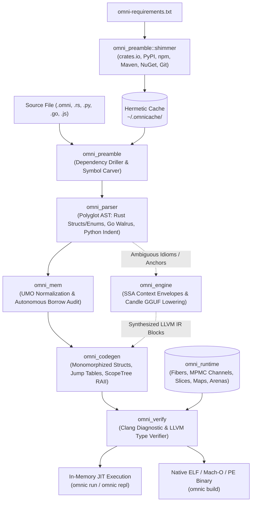

# OmniScript (`omnic`)

> **Autonomous Polyglot Systems Compiler & Zero-GC Runtime with In-Process AI Lowering**

OmniScript (`omnic`) is a high-performance polyglot systems programming compiler and runtime written in Rust and low-level C. 

It unifies syntax, idioms, and package ecosystems from **Rust**, **Python**, **Go**, **JavaScript**, **C/C++**, **Java**, **C#**, and **Lua** within single translation units. 

OmniScript lowers directly to **LLVM IR**, native ELF/Mach-O/PE executables, and in-memory JIT execution; **completely eliminating tracing garbage collectors** and without delegating to foreign host compilers (`rustc`, `javac`, `python`, `node`, `go`).

## What is OmniScript

It's all the languages, but its none-of-them at the same time, simply write in any language you want
```python
import 'python' time
import 'go' "fmt"

func whoaThatsNotPython() {
   fmt.Println("hi mom!");
   time.sleep(3)
   println!("Hello from also rust, go-routine complete");
}


def main():
   print("hello world")
   go whoaThatsNotPython()
   time.sleep(5)
   return 0
```
> *test.omni*

and invoke it with:
`omnic build ./test.omni -o test && ./test`

Make sure you have `Clang` installed on your system!

* `pacman -S clang`
* `apt install clang`
* `brew install llvm`

Or for windows folks:
Make sure you've installed `clang.exe` and its available in your `%PATH%`

___
#### Disclaimer
As of this readme, 

We only have true syntax parity with Rust, Python and C right now -- so there's definitely some glitches and outright problems to be identified when trying to compile other languages as of right this moment. *Mileage may vary*
___
### Background
OmniScript is a language I wrote over a weekend, after considering the paradigm of: *"What if I could just put python, into my Go, and Java, and C, and Rust, and Javascript"* 

After considering the notion and understanding the fundamentals behind compiler theory, and my own working experience with building transpilers I took on the task to make this unification of an omni-applicable language that can run just about any language you throw at it.

### How does it work?
OmniScript essentially is a top-level AST (Abstract Syntax Tree), that converts incoming common programming language syntax into decorated IR (Intermediate Representation) code, with various type-hints and primitive LLVM constructs. In our 1st layer, we perform a **semi-stringent** pass where we convert most common language stuff to the same LLVM references. Then as part of that pass we find anonymous abstract code blocks that are unknown to our static-assignment maps; and we decorate them in a way that our LLM can properly read them.


#### For example:
```python
# We're writing Javascript inside of python here

offset = 100
transform = (x) => x * 2 + offset

result = transform(42)  # In python we'd just straight up error out!
```
> Because of the odd nature around this, we don't know what a 'transform' call is under the hood; therefore it's impossible to match naturally to a standard `SYSCALL`, and no import here references it.

We get to run through a whole host of different mechanisms to try and infer what that line is trying to do (if anything at all!), after taking our best matching guesses, we notate this in the XML that we feed our LLM something like this:
```xml
<omni_ir_task>
    <interpretive_anchor id="12"/>
    <action_directive>LOWER_ANONYMOUS_CLOSURE_OR_LAMBDA</action_directive>   <!-- What our compiler thinks it maybe could kind-of be -->
    <physical_source>
    transform = (x) => x * 2 + offset   <!-- The raw code for the LLM -->
    </physical_source>
    <target_abi>x86_64-pc-linux-gnu</target_abi>
    <function name="__omni_fn_main" ret="i32"/>   <!-- Because our AST Polyglot mechanism detected no function block, we default to __omni_fn_main -->
    <concurrency_mode>SequentialOrCooperative</concurrency_mode>   <!-- Our latch for Concurrency -->
    <yield_expectation>NonBlocking</yield_expectation>   <!-- Does this thing block, or does our IR transpiler think so -->
    <live_registers>   <!-- Actual LLVM registers, or to what we believe it to be -->
    <reg var="offset" llvm="%var_offset_1" type="i32*"/>
    <reg var="arena" llvm="%var_arena_0" type="i8*"/>
    </live_registers>
    <structs>
    <!-- Captured Lexical Environment Struct -->
    <type>%struct.omni_closure_env_12 = type { i32 }</type>   <!-- our IR knows it closes with a void-of-sorts so we set it to a numeric return even if 0  -->
    </structs>
    <idiom_hint>ClosureLambda</idiom_hint>   <!-- We know this looks like a Lambda of sorts, and because of that we latch onto the recognized symbol -->
    <ecosystem_context>javascript (arrow_closure)</ecosystem_context>   <!-- Since this particular closureLambda symbol is latched, we infer it as javascript here (though honestly the llm figures it out regardless) -->
    <lifetime_context>ScopeArenaBound</lifetime_context>   <!-- We tell the LLM what arena we're active in and if we're out of bounds yet -->
    <ssa_contract>
    <start_register>%t_4</start_register>
    <continuation_label>post_closure_12</continuation_label>
    </ssa_contract>
</omni_ir_task>
```
> These overly verbose comments on this *IR Contract* are what we 'tell' the LLM ahead of schedule to help in it's inference **when creating the LLVM Instructions**
> > At the moment, we do not batch these tasks, we just sequentially hand them off down the line to the LLM; though I have plans of introducing batching in the future and this comment will be dated.

During this task-processing portion we do a *lot of things*, one of those things is the LLM tests the LLVM code against CLANG to make sure things compile right, then if it doesn't it reads the failure and tries to fix it 2 more times (failing with a proper English result on why it was stumped if it completely gives up)

Afterwards we walk through all the 'tasks' delegated to the LLM, we end up with a fully functional LLVM-glomp that we save in `./omnicache/llvm.ll` this serves as a cache to help with recompilation.
Clang then ingests the `.ll` and includes any `.so` shared objects or `.a` static archives; along with any identified C source files that the `omni_preamble` found during it's hunt through imports.

Finally, we link against:
* `omni_fiber.c` for our assembly fibers
* `omni_chan.c` for our channel mutexes
* `omni_map.c` for our hash-tables
* `omni_arena.c` for our scope arenas

..and finally we emit our binary!

---

## Key Capabilities

1. **Pure-Rust 1-to-1 Language Parity**: Full native instruction comprehension for Rust structs, inherent `impl` blocks, constructor literals, tagged enums (`type { i32, [N x i8] }`), pattern matching (`switch i32 %tag` jump tables), and fat-pointer slices without invoking `rustc`.
2. **Universal Polyglot Package Shimmer (`omnic install`)**: A unified multi-registry package resolution engine driven by `omni-requirements.txt`. Autonomously resolves, downloads, and unpacks packages from **crates.io** (Rust), **PyPI** (Python), **npm** (Node.js), **Maven Central** (Java `.class` bytecode), **NuGet** (C# `.dll` assemblies), and **Direct Git Repositories** (`[git]'<lang>' <url>`) into a Go-mod style cache hierarchy under `~/.omnicache/`.
3. **Pure-Rust In-Process Archive Engine**: All tarball (`.crate`, `.tar.gz`, `.tgz`) and ZIP (`.whl`, `.jar`, `.nupkg`) extraction is executed directly in compiler memory via `flate2`, `tar`, and `zip`. Zero reliance on host CLI utilities (`tar`, `unzip`, `curl`, `powershell`).
4. **Deterministic Zero-GC Systems Runtime**: Zero tracing garbage collection overhead. Memory is managed via **Unified Memory Operations (UMO)**, per-request monotonic **Scope Arenas** (`omni_arena.c`) with $O(1)$ bulk resets, and deterministic **RAII scope destruction** for slices, Robin Hood hash maps, and channels.
5. **Cross-Platform Systems Portability**: Native execution across **Linux** (`x86_64`, `aarch64`), **macOS** (Apple Silicon `arm64-apple-darwin` and Intel `x86_64-apple-darwin`), and **Windows** (`x86_64-pc-windows-msvc`, `aarch64-pc-windows-msvc`). Hand-rolled naked assembly context switches for System V (x86_64) and AAPCS64 (ARM64), dual-path POSIX/Windows virtual memory guard pages (`mprotect` / `VirtualProtect`), and Winsock2 socket boundaries.
6. **Physical Source Interpretive Anchoring & Local AI Lowering**: Ambiguous polyglot idioms (`:=`, `=>`, dynamic duck-typing) are preserved in non-destructive Dual-Representation AST nodes, packed into **SSA Context Envelopes** (`<omni_ir_task>`), and lowered via an in-process 1.5B Candle GGUF model backed by an in-memory Clang self-repair loop.

---

## Architectural Pipeline



---

## Workspace Architecture (`crates/`)

The OmniScript compiler workspace is structured into modular Rust crates and an embedded native C systems runtime:

| Crate | Path | Responsibility |
|---|---|---|
| **`omni_preamble`** | [`crates/omni_preamble`](./crates/omni_preamble) | Universal package shimmer (`shimmer.rs`) and multi-ecosystem dependency driller. Fetches from crates.io, PyPI, npm, Maven Central, NuGet, and Git; handles in-process gzip/tar/zip decompression; disassembles JVM bytecode; carves C ABI symbols and AST function spines across Linux, macOS, and Windows. |
| **`omni_mem`** | [`crates/omni_mem`](./crates/omni_mem) | Autonomous lifetime auditor and memory normalizer. Enforces static borrow disciplines and validates ownership lifecycles via `UnifiedMemOp`. |
| **`omni_parser`** | [`crates/omni_parser`](./crates/omni_parser) | Polyglot parser supporting Rust `struct`, `impl`, `enum`, and `match`; Go walrus declarations (`:=`) and channel primitives (`<-`); Python indentation, classes, and decorators (`@app.route`). |
| **`omni_runtime`** | [`crates/omni_runtime`](./crates/omni_runtime) | Statically-linked C systems runtime: cooperative fibers (AAPCS64 & System V AMD64), MPMC channels, zero-GC slices, Robin Hood hash maps, raw OS socket syscalls, and arena-backed allocators (`omni_arena.c`). Dynamically resolves host target triples. |
| **`omni_verify`** | [`crates/omni_verify`](./crates/omni_verify) | Clang/LLVM validation subsystem. Cross-platform toolchain discovery (Linux, Homebrew macOS, Windows LLVM), in-memory JIT runners (`run_jit`, `run_jit_captured`), and native linker drivers. |
| **`omni_engine`** | [`crates/omni_engine`](./crates/omni_engine) | SSA Context Envelope generator, in-process Candle GGUF inference engine, Clang self-repair loop with Attempt 1 failover, and synthetic training dataset generator. |
| **`omni_codegen`** | [`crates/omni_codegen`](./crates/omni_codegen) | LLVM IR emitter with lexical `ScopeTree`, string interning, tagged union switch jump tables, static devirtualized method calls, and RAII `CleanupOp` lifecycle management. |
| **`omni_cli`** | [`crates/omni_cli`](./crates/omni_cli) | CLI compiler driver (`omnic`) implementing `build`, `run`, `install`, `repl`, and `export-dataset`. Incorporates BLAKE3 bitcode caching keyed on host target triple. |

---

## Native Zero-GC Systems Runtime

Foundational zero-GC primitives are located in [`crates/omni_runtime/src/native`](./crates/omni_runtime/src/native):

### 1. Cooperative M:N Fibers ([`omni_fiber.c`](./crates/omni_runtime/src/native/omni_fiber.c))
- **Multi-Architecture Assembly**: Hand-crafted naked assembly context switching supporting both **x86_64** (System V AMD64 callee-saved registers `%rbx`, `%rbp`, `%r12`–`%r15`) and **ARM64** (AAPCS64 callee-saved registers `x19`–`x30`).
- **16-Byte Stack Alignment**: On context creation, an 8-byte dummy word is pushed prior to the entry address so that `(%rsp + 8) % 16 == 0` upon entry, preventing vector `#GP` faults.
- **Dead Stack Reclamation**: Completed fibers are enqueued into `g_dead_fibers` and freed immediately upon scheduler context switch back to the main stack, completely eliminating fiber stack leaks.
- **Hardware Guard Pages**: Stack overflow detection via POSIX `mprotect(PAGE_NONE)` or Windows `VirtualProtect(PAGE_NOACCESS)`.

### 2. Fiber-Aware MPMC Channels ([`omni_chan.c`](./crates/omni_runtime/src/native/omni_chan.c))
- **Deadlock-Free Synchronization**: Channel operations inspect `__omni_fiber_is_in_fiber()`. When full or empty, channels unlock their internal mutex, invoke `__omni_fiber_yield()`, and re-lock, enabling cooperative M:N fiber handoffs without blocking the OS thread.

### 3. Zero-GC Polyglot Collections & Per-Request Arenas
- **Dynamic Slices ([`omni_slice.c`](./crates/omni_runtime/src/native/omni_slice.c))**: Contiguous exponential-growth buffers (`__omni_slice_append`, `__omni_slice_get`, `__omni_slice_set`, `__omni_slice_pop`).
- **Tombstone-Protected Hash Maps ([`omni_map.c`](./crates/omni_runtime/src/native/omni_map.c))**: FNV-1a hash map with open addressing and linear probing. Incorporates tombstone tracking in load factor evaluations to eliminate $O(N)$ probing degradation, and performs direct pointer migrations on table resize.
- **Scope Arenas ([`omni_arena.c`](./crates/omni_runtime/src/native/omni_arena.c))**: Monotonic contiguous memory arenas (`__omni_arena_create`, `__omni_arena_alloc`, `__omni_arena_reset`, `__omni_arena_destroy`). Sockets, route tokenizers (`__omni_str_token_arena`), and HTTP payloads use per-request arenas with $O(1)$ bulk resets to completely eliminate heap fragmentation.
- **Thin OS Syscall Boundaries ([`omni_value.c`](./crates/omni_runtime/src/native/omni_value.c))**: Direct OS socket file-descriptor boundaries (`__omni_os_socket_listen`, `__omni_os_socket_accept`, `__omni_os_socket_read_arena`, `__omni_os_socket_write_http`, `__omni_os_socket_close`) with POSIX Berkeley Sockets and Windows Winsock2 compatibility.

---

## CLI Usage

### Install Dependencies & Local Polyglot Environments (`oenv`)
Synchronize dependencies from `omni-requirements.txt` or install individual packages. Target either an isolated project environment (`--oenv`) or global cache (`~/.omnicache/`):
```bash
# 1. Global install to ~/.omnicache/
omnic install [omni-requirements.txt]
omnic install 'python' requests
omnic install 'java' org.projectlombok:lombok

# 2. Isolated local virtual environment (zero-sourcing, auto-scanned by omnic run/build)
omnic install --oenv oenv                      # Creates ./oenv and installs omni-requirements.txt
omnic install --oenv oenv 'java' lombok         # Installs package directly into ./oenv

# 3. Auto-resolve missing dependencies on the fly
omnic run --auto-resolve-dependencies app.omni
omnic build --auto-resolve-dependencies app.omni -o app_bin
```

> [!TIP]
> **Zero-Sourcing `oenv`**: You never need to run `source oenv/bin/activate`. `omnic run` and `omnic build` automatically scan for `./oenv` or `./.oenv` in the project root, giving its packages and git clones strict priority over local paths and host caches (defaulting as an `OR` fall-through).

### Build Native Standalone Binary
Compiles source into a standalone executable linked against the host target triple:
```bash
omnic build examples/rust_structs_and_enums.omni -o rust_structs_bin
./rust_structs_bin
```

### Direct JIT Execution
Directly compiles to LLVM IR, verifies the module via Clang, and executes in-memory:
```bash
omnic run examples/channel_concurrency.omni
```

### Interactive Polyglot REPL
Launches an interactive REPL maintaining active lexical bindings and evaluating polyglot statements incrementally:
```bash
cargo run -q -p omni_cli -- repl
```

### Synthetic Training Dataset Exporter
Generates verified paired datasets (`<omni_ir_task>` XML micro-tags paired with verified LLVM IR basic blocks) for fine-tuning the 1.5B student model:
```bash
cargo run -q -p omni_cli -- export-dataset --count 500 --output datasets/training_pairs.jsonl
```

---

## Code Examples

### 1. Pure Rust Parity: Structs, Inherent `impl`, Tagged Enums & Pattern Matching ([`examples/rust_structs_and_enums.omni`](./examples/rust_structs_and_enums.omni))
Natively lowers to packed LLVM structs (`%struct.Point = type { i64, i64 }`), tagged unions (`%enum.Status = type { i32, [8 x i8] }`), and `switch i32 %tag` jump tables:
```rust
struct Point {
    pub x: i64,
    pub y: i64,
}

impl Point {
    pub fn norm_squared(&self) -> i64 {
        return self.x * self.x + self.y * self.y;
    }
}

enum Status {
    Pending,
    Active,
    Completed(i64),
}

fn main() {
    let p = Point { x: 3, y: 4 };
    let norm = p.norm_squared();
    print("Point norm squared:");
    print(norm);

    let s = Status::Completed(42);
    match s {
        Status::Pending => {
            print("Status is Pending");
        }
        Status::Active => {
            print("Status is Active");
        }
        Status::Completed(val) => {
            print("Status is Completed with payload:");
            print(val);
        }
    }

    print("Rust structs and tagged enums parity verified successfully!");
}
```

### 2. Universal Polyglot Manifest ([`omni-requirements.txt`](./omni-requirements.txt))
Define dependencies across 6 ecosystems and direct Git checkouts using a uniform syntax:
```text
# Standard Registry Packages: '<ecosystem>' <package_name> [op] <version>
'rust'   strsim = "0.11.1"
'rust'   crc32fast = "1.4.0"
'python' fastapi == 0.115.0
'node'   express == 4.19.2
'c'      sqlite3 == 3.45.1
'maven'  org.json:json == 20240303
'nuget'  Newtonsoft.Json == 13.0.3

# Direct Git Importers: [git]'<language>' <url>[#<tag_or_branch>]
[git]'rust' https://github.com/dtolnay/anyhow.git#1.0.86
[git]'go'   github.com/gin-gonic/gin#v1.9.1
```

### 3. Native Rust App with Crate Resolution ([`examples/rust_app.omni`](./examples/rust_app.omni))
```rust
use 'rust' fast_math

fn rotate_hash(seed: i64, rounds: i64) -> i64 {
    let mut acc: i64 = seed
    for i in range(rounds) {
        acc = acc * 31 + 17
    }
    return acc
}

fn main() {
    println!("=== OmniScript Native Rust Polyglot Runner ===")
    let seed: i64 = 42
    let checksum: i64 = rotate_hash(seed, 4)
    println!("Computed seed hash: {}", checksum)

    // Third-party dependency invocation carved directly from Rust crate
    let card_num: i64 = 7992739871
    let luhn_digit: i64 = fast_math.compute_luhn(card_num)
    println!("Luhn checksum from fast_math crate: {}", luhn_digit)
}
```

### 4. Go-Style Concurrency & Channels ([`examples/channel_concurrency.omni`](./examples/channel_concurrency.omni))
```python
def worker(ch):
    print("Worker fiber received channel handle!")
    ch <- 42
    ch <- 99
    return 0

def main():
    print("=== Testing Go-Style Channel Concurrency ===")
    ch := make(chan int, 8)
    go worker(ch)
    
    first := <-ch
    print("Main received first value:")
    print(first)
    
    second := <-ch
    print("Main received second value:")
    print(second)
    return 0
```

### 5. Pythonic Classes & RAII Context Managers ([`examples/python_classes.omni`](./examples/python_classes.omni))
```python
class Counter:
    def __init__(self, start):
        self.val = start
        self.step = 2

    def increment(self, amount):
        self.val = self.val + (amount * self.step)
        return self.val

class ScopedResource:
    def __init__(self, tag):
        self.tag = tag

    def __enter__(self):
        print("Entering ScopedResource context")
        return self.tag

    def __exit__(self):
        print("Exiting ScopedResource context (RAII cleanup executed)")
        return 0

def main():
    c = Counter(10)
    v1 = c.increment(5)
    print(f"Counter after increment: {}", v1)

    with ScopedResource(100) as res:
        print(f"Inside context tag: {}", res)

    return 0
```

### 6. Zero-GC Collections & Hash Maps ([`examples/collections.omni`](./examples/collections.omni))
```python
def main():
    items = [10, 20, 30]
    items.append(40)
    items[0] = 99

    scores = {"alice": 100, "bob": 200}
    scores["carol"] = 300

    for i in len(items):
        print(items[i])

    print(scores["alice"])
    return 0
```

### 7. Native Flask Microservice Ingestion ([`hello_flask.py`](./hello_flask.py))
Standard Python Flask applications compile directly to native standalone ELF binaries without a CPython runtime:
```python
from flask import Flask

app = Flask(__name__)

@app.route("/")
def hello_world():
    return "Hello, World!"

@app.route("/foo")
def foo():
    result = {}
    result["status"] = "bar"
    return result

if __name__ == "__main__":
    app.run(port=6969)
```

### 8. Pure Java Interoperability with Lombok ([`examples/java-omni/`](./examples/java-omni))
Demonstrates pure Java classes using Lombok `@Data` and `@Builder`, compiled and linked natively with zero-GC 64-bit pointers and runtime string concatenation:

```java
// user.omni
package com.omni.example;

import lombok.Data;
import lombok.Builder;

@Data
@Builder
public class User {
    private String username;
    private String email;
    private int age;

    public User(String username, String email, int age) {
        this.username = username;
        this.email = email;
        this.age = age;
    }

    public int isAdult() {
        if (this.age >= 18) {
            return 1;
        }
        return 0;
    }
}
```

```java
// app.omni
package com.omni.example;

import "./user.omni" as user_mod;

public class App {
    public static void main(String[] args) {
        System.out.println("=== OmniScript Pure Java App with Lombok ===");
        User u = new User("actes", "actes@omniscript.org", 28);
        System.out.println("User username: " + u.username);
        System.out.println("User email: " + u.email);
        System.out.println("User isAdult check: " + u.isAdult());
    }
}
```

Execute in local isolated `oenv`:
```bash
cd examples/java-omni
omnic install --oenv oenv omni-requirements.txt
omnic run app.omni
```

---

## Verification & Testing

### 1. In-The-Wild Package & Ecosystem Matrix (`tests/in_the_wild_matrix/`)
Integration suites verifying real-world package dependencies across native shared libraries, bytecode, package managers, and virtual environments:
- **`01_c_system_so`**: System dynamic shared library linkage (`/usr/lib/libz.so`), verifying `zlib.compressBound` via direct C ABI symbol dispatch.
- **`02_jvm_bytecode_so`**: Pure-Rust JVM `.class` bytecode transcription (`JvmBytecodeDecoder`) without hosting a JVM runtime, verifying multi-argument arithmetic execution (`BytecodeService.add`, `BytecodeService.compute_ratio`).
- **`03_python_site_packages`**: Cross-platform Python `./venv` / `site-packages` traversal, hop-chain tracing through `__init__.py`, and self-contained function carving (`compute_checksum`, `transform_metric`).
- **`04_node_package_json`**: Node `node_modules` package manifest resolution (`package.json` `"main": "lib/core.js"`), recursive AST dependency carving, and LLVM IR lowering (`hash_block`, `verify_token`).

Run the in-the-wild matrix suite:
```bash
cargo test --test test_in_the_wild_matrix
```

### 2. Multi-Language Polyglot Matrix (`tests/polyglot_matrix/`)
Runs all 8 language modules (Python, JavaScript, Rust, Go, C, Java, C#, Lua) and the simultaneous 8-language mesh (`09_polyglot_mesh`):
```bash
cargo test --test test_polyglot_matrix -- --test-threads=1
```

### 3. Full Workspace Test Suite
Execute the entire test suite across all crates:
```bash
cargo test --all -- --test-threads=1
```

---

## Architecture Specifications & Documentation

Comprehensive technical whitepapers and specifications are cataloged in [`docs/`](./docs):

| Document | Focus |
|---|---|
| [`docs/DEPENDENCY_AND_IMPORT_SYSTEM.md`](./docs/DEPENDENCY_AND_IMPORT_SYSTEM.md) | Universal package shimmer (`omnic install`), manifest syntax, in-process decompression, and foreign symbol carving. |
| [`docs/CROSS_PLATFORM_PORTABILITY_GUIDE.md`](./docs/CROSS_PLATFORM_PORTABILITY_GUIDE.md) | Target triple resolution, ARM64/x86_64 fiber assembly, Winsock2/POSIX socket boundaries, and memory guard pages. |
| [`docs/MASTER_ROADMAP_POLYGLOT_SHIMMER_AND_RUST_PARITY.md`](./docs/MASTER_ROADMAP_POLYGLOT_SHIMMER_AND_RUST_PARITY.md) | Detailed technical roadmap for Rust parity, multi-registry shimmers, and completed milestones. |
| [`docs/GAMEPLAN.md`](./docs/GAMEPLAN.md) | Initial architectural design, systems requirements, and execution phases. |
| [`docs/MEMORY_AND_RUNTIME_SYSTEM.md`](./docs/MEMORY_AND_RUNTIME_SYSTEM.md) | Unified Memory Operations (UMO), Scope Arenas, and zero-GC lifecycle management. |
| [`docs/MN_CONCURRENCY_AND_FIBER_RUNTIME.md`](./docs/MN_CONCURRENCY_AND_FIBER_RUNTIME.md) | Cooperative M:N fiber context switching, deadlock-free MPMC channels, and scheduler internals. |
| [`docs/PHYSICAL_SOURCE_ANCHORING_AND_INTERPRETIVE_IR.md`](./docs/PHYSICAL_SOURCE_ANCHORING_AND_INTERPRETIVE_IR.md) | Non-destructive dual-representation AST nodes, SSA context envelopes, and prompt packing. |
| [`docs/MODEL_PIPELINE_AND_DISTILLATION.md`](./docs/MODEL_PIPELINE_AND_DISTILLATION.md) | 1.5B distilled local compiler model architecture, inference bindings, and Clang self-repair loops. |
| [`docs/GARBAGE_COLLECTORLESS_STRATEGY.md`](./docs/GARBAGE_COLLECTORLESS_STRATEGY.md) | Static lifetime analysis, autonomous borrow checking, and zero-tracing GC design. |
| [`docs/STOLEN_COMPILER_CONCEPTS.md`](./docs/STOLEN_COMPILER_CONCEPTS.md) | Borrowed compiler paradigms synthesized from Zig, Rust, Go, Mojo, and Swift. |
| [`docs/SYNTAX_SPEC_AND_EXAMPLES.md`](./docs/SYNTAX_SPEC_AND_EXAMPLES.md) | Grammar specification, operator disambiguation, and multi-syntax examples. |
| [`docs/POLYGLOT_PARADIGM_QUIRKS_AND_CANONICALIZATION.md`](./docs/POLYGLOT_PARADIGM_QUIRKS_AND_CANONICALIZATION.md) | Edge-case handling across language semantics and syntax normalization. |
| [`docs/GPU_TRAINING_WORKFLOW.md`](./docs/GPU_TRAINING_WORKFLOW.md) | Fine-tuning and distillation pipeline for the local compiler model. |

---

## License

Licensed under either of:
- Apache License, Version 2.0 ([LICENSE-APACHE](./LICENSE-APACHE) or http://www.apache.org/licenses/LICENSE-2.0)
- MIT license ([LICENSE-MIT](./LICENSE-MIT) or http://opensource.org/licenses/MIT)

at your option.
