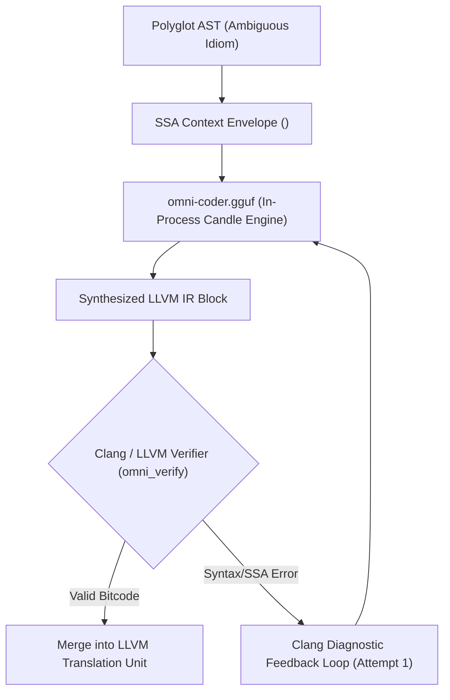

# OmniScript Compiler Inference Models (`models/`)

This directory houses the local distilled language models utilized by OmniScript's in-process neural compiler engine ([`crates/omni_engine`](../crates/omni_engine)).

---

## 1. Model Overview: `omni-coder.gguf`

- **Filename**: `omni-coder.gguf`
- **Format**: GGUF v3 (Quantized weights optimized for in-process Candle inference on CPU AVX2/NEON and CUDA).
- **Footprint**: ~1.05 GB (1,125,049,856 bytes).
- **Base Architecture**: 1.5B Parameter Code LLM (Qwen2.5-Coder derivative).
- **Quantization Level**: 4-bit / 5-bit mixed block quantization (`Q4_K_M` / `Q5_K_M`).

---

## 2. Compiler Function & Execution Flow

OmniScript uses a **dual-tier lowering pipeline**:
1. **Deterministic SSA Lowering**: All clear-syntax AST constructs (Rust structs, enums, Go walrus declarations, channel operations, control flow, devirtualized methods) are compiled directly to LLVM IR deterministically without AI involvement.
2. **Interpretive Neural Lowering (The In-Process Student Engine)**:
   - When encountering ambiguous polyglot idioms (e.g., dynamic duck-typing, complex polyglot operator combinations, un-annotated closures across foreign ABI boundaries), the compiler encapsulates the AST subgraph and live symbol table into an **SSA Context Envelope** (`<omni_ir_task>`).
   - The envelope is passed in-memory to `omni-coder.gguf` via Candle.
   - The model generates candidate LLVM IR basic blocks adhering to target ABI constraints.
   - The synthesized IR is immediately validated against an in-memory Clang/LLVM verification harness (`omni_verify`). If Clang detects diagnostic errors, the compiler triggers an automated self-repair loop feeding compiler error messages back to the model.



---

## 3. Placement & Download

### Direct Download from Release v0.1.0
To download the compiled model weights into the `models/` directory:
```bash
mkdir -p models
curl -L -o models/omni-coder.gguf https://github.com/actes2/omniscript/releases/download/v0.1.0/omni-coder.gguf
```

You can customize the model directory path via the environment variable:
```bash
export OMNI_MODEL_DIR="/path/to/custom/models"
```

To upload model weights over the local network to a headless build server, use the included helper script:
```bash
python3 scripts/upload_server.py
# In another terminal:
curl -T omni-coder.gguf http://<HOST_IP>:8080/upload
```

